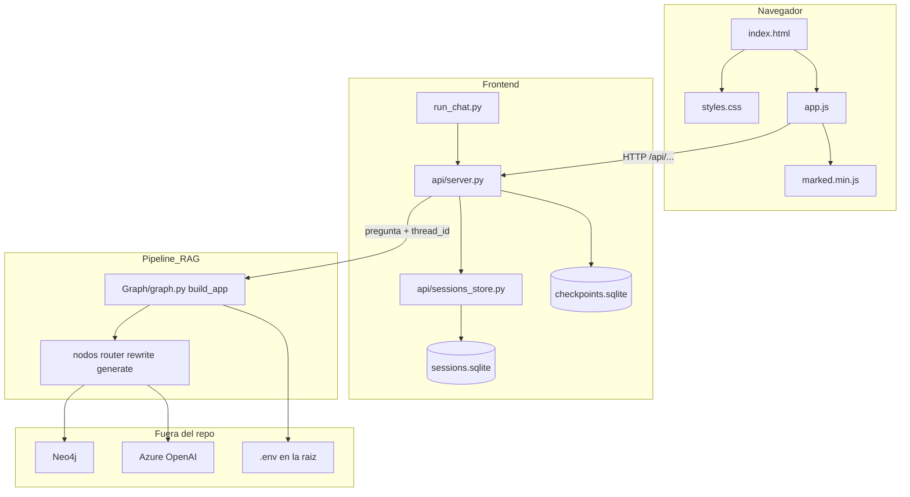
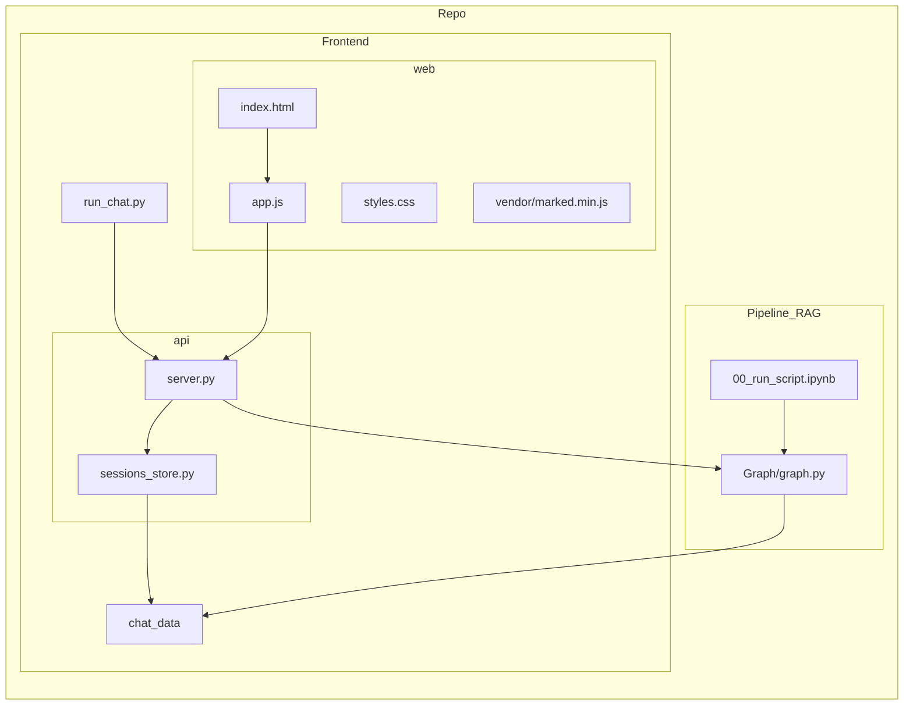
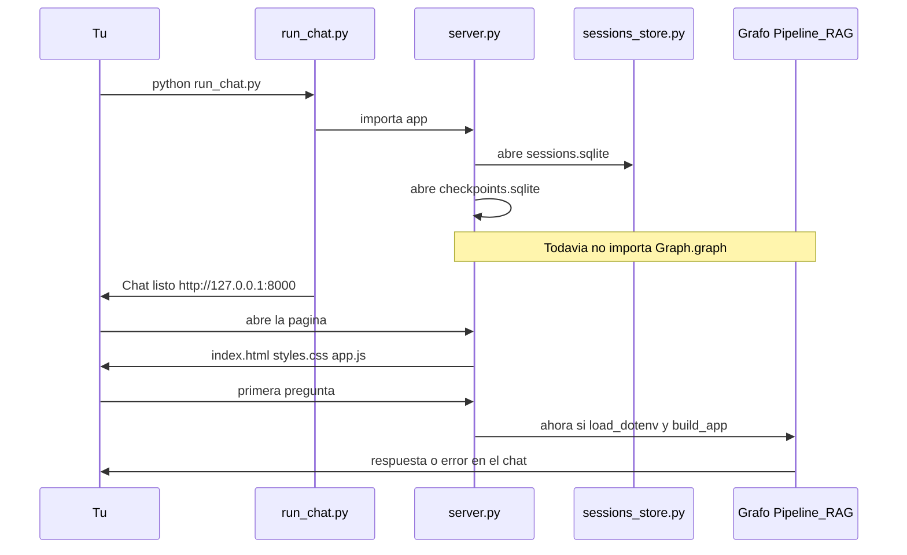
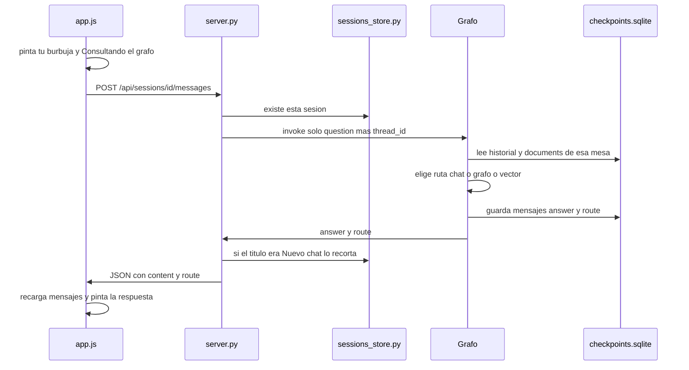
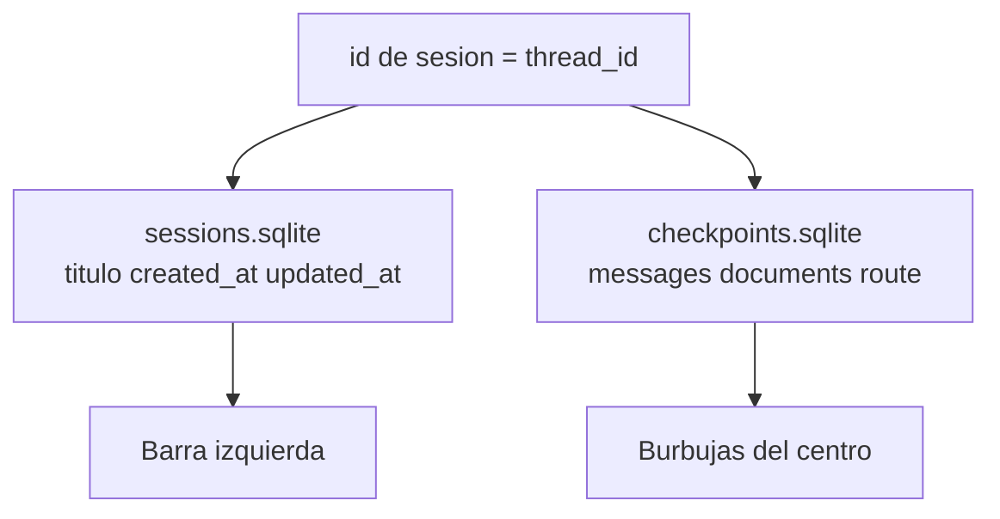
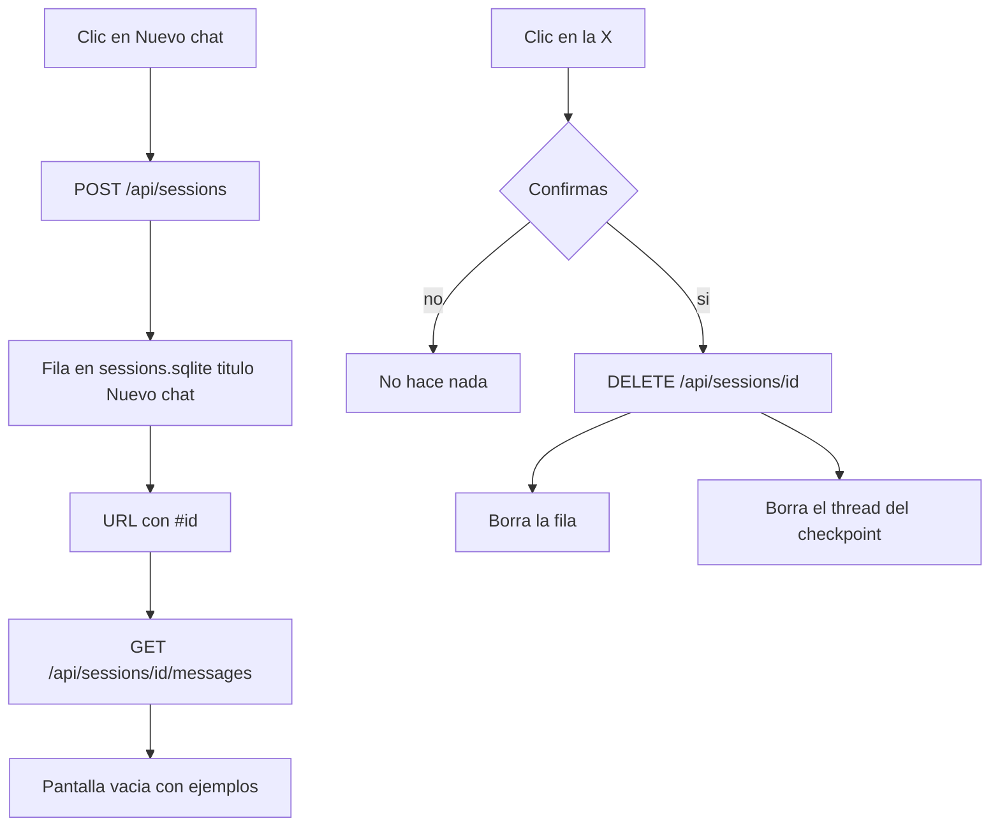

# El chat del GraphRAG, explicado sin tecnicismos

Este archivo traduce el plan de [PLAN_chat_frontend.md](PLAN_chat_frontend.md). Ese plan está escrito para quien va a programar. Este es para entender **qué se construyó, por qué, y qué hace cada pieza**.

El chat **ya está implementado**. Vive en la carpeta `Frontend/`. El cerebro (el grafo, Neo4j, Azure) sigue en `Pipeline_RAG/`.

Si vienes por los dibujos o por un archivo concreto:

- [Sección 8 — diagramas de arquitectura](#8-diagramas-de-arquitectura)
- [Sección 9 — qué hace cada archivo](#9-qué-hace-cada-archivo-uno-por-uno)

---

## 1. El problema que resolvía el plan

Antes del chat, el sistema solo se usaba desde un notebook de Jupyter: escribías una pregunta en una celda, corrías el código y leías la respuesta.

Eso tenía tres límites:

1. **No se veía como un chat.** No había pantalla con burbujas, ni barra de conversaciones.
2. **Cada pregunta empezaba de cero** si no usabas un truco de “sesión” en el notebook. No podías decir “explícame el primero” y esperar que el sistema recordara la lista anterior.
3. **Al cerrar el notebook se olvidaba todo.** La memoria vivía solo en la RAM del proceso.

El plan no era reinventar el GraphRAG. Era **ponerle una cara** tipo Claude o ChatGPT: varias conversaciones, historial, y que al reiniciar el servidor los chats sigan ahí.

---

## 2. La idea central, en una frase

El front **no responde** las preguntas. Solo muestra la conversación y le pide la respuesta al grafo que ya existía.

Piensa en un restaurante:

- Tú (el navegador) hablas con el mesero.
- El mesero (`Frontend/`) anota la mesa, el pedido y te trae el plato.
- La cocina (`Pipeline_RAG/` + Neo4j + Azure) es la que cocina.

Si cambias de mesa (otra sesión), la cocina no mezcla los platos.

---

## 3. Qué ves en la pantalla

Una sola página, en español, sin instalar Node ni “compilar” el front.

**Barra izquierda (sesiones)**

- Botón **Nuevo chat**: abre una conversación vacía.
- Lista de chats. El activo se ve resaltado.
- Doble clic en el título para renombrarlo.
- La **×** borra el chat (pide confirmación).
- Borrar un chat borra también su memoria.

**Centro (el hilo)**

- Si el chat está vacío: un texto corto y 2 o 3 preguntas de ejemplo. Al hacer clic, se copian al cuadro de abajo.
- Tus mensajes van a la derecha.
- Las respuestas van a la izquierda, con formato (negritas, listas, código).
- Debajo de la última respuesta del asistente puede aparecer una etiqueta: *Conversación*, *Consulta al grafo* o *Búsqueda vectorial*. Eso dice **por qué camino** pasó esa pregunta (ver sección 7).

**Abajo (el cuadro para escribir)**

- Enter envía. Shift+Enter hace un salto de línea.
- Mientras el grafo trabaja, el cuadro se bloquea y aparece “Consultando el grafo…” / “Consulta en curso…”.
- Si cambias de chat mientras una respuesta sigue en camino, al volver se recargan los mensajes de ese chat.

**La dirección del navegador**

Al abrir un chat, la URL queda algo como `http://127.0.0.1:8000/#un-codigo-largo`. Ese código es el identificador de la sesión. Si recargas la página, vuelves al mismo chat.

---

## 4. Cómo viaja una pregunta (el flujo)

```text
Tú escribes
    → la página (Frontend/web)
    → el servidor (Frontend/api)
    → el grafo (Pipeline_RAG)
    → Neo4j y/o Azure
    → el servidor guarda la respuesta
    → la página muestra la burbuja
```

Paso a paso, cuando das Enter:

1. El navegador manda el texto al servidor: “esta sesión, este mensaje”.
2. El servidor busca esa sesión en la lista de chats. Si no existe, dice que no la encontró.
3. Si el título todavía es “Nuevo chat”, lo cambia por las primeras palabras de tu pregunta (máximo unos 60 caracteres).
4. El servidor le pasa **solo la pregunta** al grafo. No le reenvía los hallazgos viejos: esos ya están guardados de turnos anteriores. Si los pisara con vacío, un “explícame el primero” no sabría de qué lista hablas.
5. El grafo decide la ruta (sección 7), busca o conversa, y escribe una respuesta en prosa.
6. El servidor devuelve el texto y la ruta. La página pinta la burbuja.

La página se abre **sin esperar a Neo4j**. La primera pregunta es la que conecta con la base y con Azure. Si eso falla, el error sale **en el chat**, no como una página en blanco.

---

## 5. Qué es una “sesión” y por qué hay dos archivos

Una sesión es **un chat**: su título en la barra y todo lo que se habló ahí.

Hace falta **guardar dos cosas distintas**, y por eso hay dos archivos (ambos en `Frontend/chat_data/`, y no se suben a Git):

| Archivo | Qué guarda | Para qué sirve |
|---|---|---|
| `sessions.sqlite` | id, título, fechas | La barra izquierda: nombre, orden, crear/borrar/renombrar |
| `checkpoints.sqlite` | historial, hallazgos del grafo, última ruta | Que el grafo recuerde “el primero”, los documentos y los mensajes |

**Por qué no un solo archivo.** El “cuaderno de la cocina” (el checkpointer del grafo) guarda el estado interno del flujo. No guarda un título lindo ni sabe ordenar “el chat que toqué hace un rato”. Eso lo lleva una lista aparte.

**El id es el mismo en los dos.** Es un código único (un UUID). En el grafo se llama `thread_id`. Es el número de mesa: título y memoria apuntan a la misma mesa.

**Al borrar un chat** se borra la fila de la lista **y** la memoria de esa mesa.

Si alguna vez usaste el chat cuando todavía vivía dentro de `Pipeline_RAG/chat_data`, el primer arranque copia esos archivos a `Frontend/chat_data`.

---

## 6. Dos memorias distintas (esto importa para el TG)

El grafo se puede “encender” de dos maneras. Es el **mismo flujo** (mismos pasos, mismas reglas). Cambia **dónde se anota** lo hablado.

| Quién lo usa | Dónde vive la memoria | Qué pasa al cerrar |
|---|---|---|
| Notebook (`00_run_script.ipynb`) | Solo en la RAM (`MemorySaver`) | Se olvida |
| Chat web | En disco (`SqliteSaver`, el archivo de checkpoints) | Sigue ahí |

Por eso el plan pide una función `build_app(...)`:

- El notebook la llama **sin** argumento → memoria temporal, como antes.
- El chat le pasa el almacén en disco → las sesiones sobreviven.

No se tocó el router, los prompts, los embeddings ni las consultas Cypher. El chat no inventa otra forma de preguntarle a Neo4j.

---

## 7. Las tres rutas de una pregunta

El grafo ya sabía elegir camino. El chat **muestra** esa elección.

| Ruta | En la pantalla | Qué significa | Ejemplo |
|---|---|---|---|
| `vector search` | Búsqueda vectorial | Busca por parecido de significado (descripciones, temas) y luego consulta el grafo | “modelos relacionados con clasificación de texto” |
| `graph query` | Consulta al grafo | Pregunta estructural: conteos, filtros, un autor concreto, un id | “¿cuántos downloads tiene X?” |
| `chat` | Conversación | Habla de lo **ya encontrado**, sin volver a Neo4j | “explícame el primero”, “compáralos” |

Reglas que importan:

- En un chat **nuevo** (sin hallazgos) nunca debería ir a *Conversación*. No hay “el primero”.
- “Eso” o “el primero” **no** implican *Conversación* por sí solos. Si pides un dato que no está (likes, otro autor), vuelve al grafo. Antes, un paso reescribe “el primero” como un id real.

La etiqueta de la ruta solo se puede reconstruir con certeza en **el último** mensaje del asistente. El estado del grafo guarda la ruta del último turno, no de todos los anteriores.

---

## 8. Diagramas de arquitectura

Hay tres capas. La página no habla con Neo4j ni con Azure. Solo habla con el servidor de `Frontend/`. Ese servidor sí llama al grafo. El grafo sí habla con Neo4j y Azure.

### 8.1 Vista de capas (quién habla con quién)



Lectura del dibujo:

- Arriba: lo que ves.
- En el medio: el mesero y dos cuadernos (títulos vs memoria del grafo).
- Abajo: la cocina. El front no la reescribe; solo la enciende.

### 8.2 Mapa de carpetas (dónde vive cada pieza)



El notebook y el chat **comparten** `Graph/graph.py`. No comparten la memoria: el notebook usa RAM; el chat usa `chat_data/checkpoints.sqlite`.

### 8.3 Qué pasa al encender el servidor

La página tiene que abrir **ya**, aunque Neo4j tarde. Por eso el grafo se carga perezoso: el puerto abre primero; Azure y Neo4j se tocan en la primera pregunta.



### 8.4 Enviar un mensaje (el camino completo)



Regla crítica: el `invoke` manda **solo** `{question: "..."}`. Los hallazgos (`documents`) ya están en el checkpoint. Si se reenviaran vacíos, “explícame el primero” se quedaría sin lista.

### 8.5 Dos cuadernos, un mismo id de mesa



Borrar un chat borra **los dos** lados. Si solo se borrara el título, la memoria huérfana seguiría en disco.

### 8.6 Crear, abrir y borrar un chat



---

## 9. Qué hace cada archivo, uno por uno

Árbol real de `Frontend/`:

```text
Frontend/
  run_chat.py
  api/
    server.py
    sessions_store.py
  web/
    index.html
    styles.css
    app.js
    vendor/marked.min.js
  chat_data/                 se crea al usar el chat
    sessions.sqlite
    checkpoints.sqlite
  PLAN_chat_frontend.md
  EXPLICACION_PLAN_CHAT.md
```

### 9.1 `run_chat.py` — el interruptor

Es lo único que tú corres para “prender el chat”.

Hace cuatro cosas:

1. Pone `Frontend/` y `Pipeline_RAG/` en el camino de imports de Python. Sin eso, `from api.server` y `from Graph.graph` no se encuentran, porque ahora el front y el grafo viven en carpetas distintas.
2. Comprueba que existan `uvicorn` y el resto de paquetes. Si faltan, te dice que instales `requirements.txt`.
3. Abre el puerto **8000** en `127.0.0.1` **y** en `::1` (IPv6). En Windows, `localhost` a veces entra por IPv6. Si solo escuchara IPv4, el navegador podía decir que no abre.
4. Arranca Uvicorn con la `app` de `server.py` y deja la terminal ocupada hasta que la cierres con Ctrl+C.

Si el 8000 está reservado por Windows (`WinError 10013`), este archivo es el que hay que cambiar: la línea `port = 8000`.

No responde preguntas. No pinta burbujas. Solo enciende el servidor.

### 9.2 `api/server.py` — el mesero

Es el archivo más importante del front. Recibe lo que manda el navegador y decide a quién pedírselo.

**Al importarse** (cuando `run_chat.py` arranca):

- Añade `Frontend/` y `Pipeline_RAG/` al `sys.path`.
- Abre (o crea) `checkpoints.sqlite` con `SqliteSaver`.
- Crea un `SessionsStore` (la lista de títulos).
- Arma la `app` de FastAPI con un **grafo perezoso** (`_LazyGraph`): todavía no importa `Graph.graph`, todavía no toca Neo4j.

**Las puertas (API)** que usa `app.js`:

| Puerta | Qué pide la página | Qué hace el servidor |
|---|---|---|
| `GET /api/sessions` | Lista de chats | Lee `sessions.sqlite`, más reciente arriba |
| `POST /api/sessions` | Nuevo chat | Crea una fila “Nuevo chat”. **No** llama al grafo |
| `PATCH /api/sessions/{id}` | Nuevo título | Renombra esa fila |
| `DELETE /api/sessions/{id}` | Borrar | Borra la fila **y** el thread en checkpoints |
| `GET /api/sessions/{id}/messages` | Historial | Lee el checkpoint, convierte human/ai en `{role, content}` |
| `POST /api/sessions/{id}/messages` | Enviar pregunta | `invoke` del grafo; devuelve `{content, route}` |

También sirve los archivos de `web/` en `/`: `index.html`, `styles.css`, `app.js`. Por eso abres `http://127.0.0.1:8000` y ves la página, no un JSON.

**Piezas internas que no se ven en la URL:**

- `_LazyGraph`: la primera pregunta dispara `load_dotenv` + `from Graph.graph import build_app`. Las siguientes reutilizan el grafo ya cargado.
- `generation_lock`: un solo `invoke` a la vez (Azure y Neo4j no se pisan). El resto de la API (listar chats, abrir otro) sigue viva.
- `graph_lock`: el grafo de LangGraph no es para usarlo desde dos hilos a la vez.
- `messages_from_state`: traduce el historial interno a algo que `app.js` entiende. La etiqueta de ruta (`chat` / `graph query` / `vector search`) se pega **solo** al último mensaje del asistente.
- `graph_failure_message`: si Neo4j o el `.env` fallan, el chat muestra un texto humano, no una página en blanco.

### 9.3 `api/sessions_store.py` — la agenda de la barra izquierda

No guarda mensajes. Solo la ficha de cada chat.

Tabla `sessions`:

- `id`: código único. Es el mismo `thread_id` que usa el grafo.
- `title`: empieza en “Nuevo chat”. Al primer mensaje se recorta la pregunta a ~60 caracteres.
- `created_at` / `updated_at`: para ordenar “el que toqué hace un rato” arriba.

Operaciones: crear, listar, leer una, renombrar, “tocar” la fecha (`touch` cuando ya tenía título), borrar.

También:

- Crea la carpeta `Frontend/chat_data/` si no existe.
- Si encontrara chats viejos en `Pipeline_RAG/chat_data/` y todavía no hay carpeta nueva, los copia. Eso es por si usaste el chat antes de moverlo a `Frontend/`.

`title_from_question` junta espacios y corta con “…” si la pregunta es larga. Eso es el nombre que ves en la barra.

### 9.4 `web/index.html` — el esqueleto vacío

No tiene los chats escritos. Solo los huecos:

- Barra izquierda: marca “GraphRAG”, botón Nuevo chat, lista vacía `#session-list`.
- Centro: título `#chat-title`, zona `#messages`, formulario con textarea y Enviar.
- En el celular: botón “Sesiones” y un fondo oscuro (`#backdrop`) para tapar el hilo cuando la barra está abierta.

Al final carga dos scripts, en este orden:

1. `marked.min.js` (para formatear respuestas)
2. `app.js` (para llenar los huecos)

Si quitaras `app.js`, verías una página oscura con el botón y el cuadro, pero **sin** lista de chats y **sin** poder enviar.

### 9.5 `web/styles.css` — cómo se ve

No tiene lógica. Solo aspecto:

- Fondo oscuro, barra a la izquierda, hilo al centro, cuadro abajo.
- Burbuja tuya a la derecha (verde oscuro); respuesta a la izquierda, más ancha.
- Chat activo resaltado; botón borrar en rojo al pasar el mouse.
- En pantallas angostas (`max-width: 800px`) la barra se esconde y sale como cajón al tocar “Sesiones”.

Si cambias colores o tamaños, es este archivo. Si cambias qué hace un clic, es `app.js`.

### 9.6 `web/app.js` — el cerebro de la página

Es el que reacciona a tus clics y habla con `server.py`. Vive todo en el navegador.

**Memoria local (se pierde al recargar; el servidor es la fuente de verdad):**

- `sessions`: la lista que pintó la barra.
- `currentId`: qué chat está abierto.
- `inflight`: si hay una pregunta en camino (`sessionId` + texto). Sirve para mostrar “Consultando el grafo…” y para no mandar dos a la vez.

**Al cargar la página:** pide `GET /api/sessions` y abre el chat del `#` de la URL, o el más reciente.

**Qué hace cada gesto:**

| Tú haces | Función | Llamada al servidor |
|---|---|---|
| Clic en Nuevo chat | `createSession` | `POST /api/sessions` |
| Clic en un título | `openSession` | `GET .../messages` |
| Doble clic en un título | `startRename` | `PATCH /api/sessions/id` |
| Clic en × | `removeSession` | `DELETE /api/sessions/id` |
| Enter o Enviar | `send` | `POST .../messages` |
| Recargar o cambiar el `#` | `openFromHash` | lista + mensajes |

Detalles que importan:

- **Enter envía, Shift+Enter baja de línea.**
- Mientras `inflight` está ocupado, el cuadro, Enviar y Nuevo chat se bloquean.
- Si el chat actual ya es “Nuevo chat” y está vacío, no crea otro: solo enfoca el cuadro.
- Las respuestas pasan por `marked` y luego se les quitan `script` y `javascript:` para no ejecutar HTML peligroso.
- La etiqueta *Conversación / Consulta al grafo / Búsqueda vectorial* sale de `message.route`.
- Si cambias de chat mientras una respuesta vuela, al volver `loadMessages` pinta lo que el servidor ya tenga de **esa** sesión.

### 9.7 `web/vendor/marked.min.js` — el traductor de formato

Librería de terceros, guardada en el proyecto (no se baja de internet al abrir el chat).

El grafo responde en markdown: `**negritas**`, listas, `código`. `app.js` llama a `marked.parse(...)` y lo convierte en HTML para la burbuja. Sin este archivo, las respuestas se verían como texto plano con asteriscos.

### 9.8 `chat_data/` — lo que sobrevive al cerrar

No es código. Se crea sola. Está en `.gitignore` (no se sube a Git).

| Archivo | Dueño | Contenido |
|---|---|---|
| `sessions.sqlite` | `sessions_store.py` | Títulos y fechas |
| `checkpoints.sqlite` | `SqliteSaver` vía `server.py` | Mensajes, hallazgos, última ruta |

Si borras esta carpeta a mano, la barra queda vacía. El grafo sigue igual; solo se olvidan los chats del front.

### 9.9 Los dos markdown de esta carpeta

- `PLAN_chat_frontend.md`: el plan original, para implementar. Corto y técnico.
- `EXPLICACION_PLAN_CHAT.md`: este archivo, para entender.

### 9.10 Fuera de `Frontend/`, lo que el chat necesita

El front no copia el pipeline. Lo llama.

| Archivo | Rol respecto al chat |
|---|---|
| `Pipeline_RAG/Graph/graph.py` | `build_app(checkpointer)`: mismo flujo, memoria en disco si el chat se la pasa |
| `Pipeline_RAG/Graph/nodes.py` y `Chains/` | Router, rewrite, Cypher, vector, generate. El front no los toca |
| `.env` en la raíz | Claves Neo4j y Azure. `server.py` las carga **en la primera pregunta** |
| `requirements.txt` | `fastapi`, `uvicorn`, `langgraph-checkpoint-sqlite` además de LangChain/Neo4j |
| `.gitignore` | Ignora `Frontend/chat_data/` |

El notebook `Pipeline_RAG/00_run_script.ipynb` sigue haciendo `from Graph.graph import app` con memoria RAM. Abrir el chat **no** cambia eso.

---

## 10. Qué no entra (a propósito)

El plan recorta para el TG. **No** hay:

- Login ni varios usuarios (cualquiera que abra esa computadora ve los mismos chats)
- Respuesta palabra por palabra mientras se genera (esperas el texto completo)
- Subir archivos
- Regenerar o editar un mensaje ya enviado
- Deshacer si el grafo falla a mitad de camino

Sobre ese último punto: el primer paso del grafo anota tu pregunta. Si después falla Neo4j o Azure, la pregunta puede quedar guardada **sin** respuesta. En esta fase no se “rebobina” el cuaderno.

---

## 11. Cómo se relaciona con el plan de memoria del pipeline

Hay otro plan en `Pipeline_RAG/PLAN_conversacion_memoria.md`. Ese es el **cerebro conversacional**:

- recordar hallazgos entre turnos
- ruta `chat` sin volver a Neo4j
- reescribir “el primero” como un id

El plan de frontend **asume que eso ya existe** y solo lo envuelve:

- cada chat = un `thread_id`
- guardarlo en disco
- pintarlo en el navegador

Sin esa memoria, el chat sería solo una caja que manda preguntas sueltas.

---

## 12. Cómo probarlo (resumen)

1. Activa el entorno: en la raíz del repo, `.\.venv\Scripts\Activate.ps1`
2. Si nunca instalaste las librerías nuevas: `pip install -r requirements.txt`
3. `cd Frontend` y `python run_chat.py`
4. Abre **http://127.0.0.1:8000** (si el 8000 está bloqueado en Windows, cambia el puerto en `run_chat.py` y abre ese)
5. Neo4j encendido y el `.env` en la raíz. Si falta, la página abre igual; el error sale al mandar la primera pregunta

Prueba corta:

1. Nuevo chat → una pregunta que busque modelos → debe ir a búsqueda o consulta al grafo.
2. En el **mismo** chat: “explícame el primero” → etiqueta *Conversación*, no vuelve a Neo4j.
3. Otro chat nuevo → “explícame el primero” → **no** debería ir a *Conversación* (no hay lista previa).
4. Cierra el servidor, ábrelo otra vez → los chats siguen en la barra.

---

## 13. Glosario (las palabras del plan original)

| Palabra del plan | En cristiano |
|---|---|
| Front / frontend | Lo que ves: página y servidor del chat |
| Pipeline / grafo | El sistema que ya respondía preguntas sobre Hugging Face en Neo4j |
| Sesión / `thread_id` | Un chat. Un número de mesa. |
| Checkpointer / `MemorySaver` / `SqliteSaver` | Dónde se anota lo hablado: RAM o archivo |
| Checkpoint | La foto del estado de un chat (mensajes, hallazgos, ruta) |
| API / endpoint | Una puerta del servidor: “dame los chats”, “manda este mensaje” |
| `invoke` | “Corre el grafo con esta pregunta” |
| `documents` | Los hallazgos crudos del último retrieval (la lista de modelos, etc.) |
| Ruta / `route` | El camino elegido: conversar, consultar el grafo o buscar por similitud |
| Hash (`#...`) | El pedazo de la URL que identifica el chat abierto |
| Worker | Una copia del servidor. Aquí hay una sola. |
| Markdown | Texto con `**negritas**` y listas que la página convierte en formato |
| CDN | Internet de terceros. `marked` está guardado en el proyecto para no depender de eso |
| Rollback | Deshacer un turno a medias. Aquí no se hace. |
