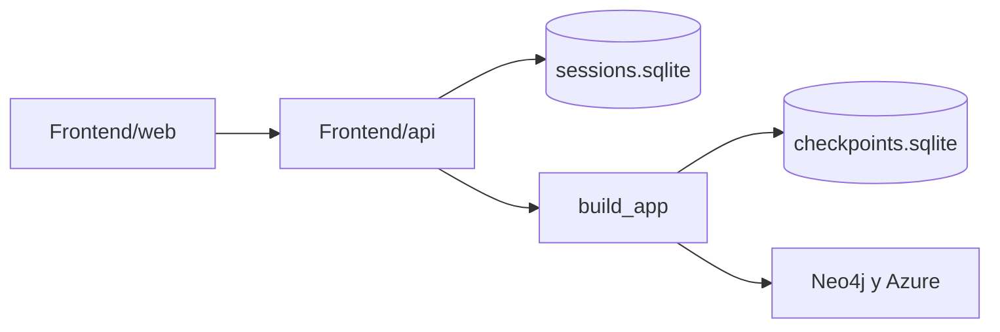

# Plan — Chat web con varias sesiones

> El chat vive en `Frontend/`. El grafo sigue en `Pipeline_RAG/`. El notebook usa `MemorySaver`.

El pipeline ya conversa. [`../Pipeline_RAG/Graph/graph.py`](../Pipeline_RAG/Graph/graph.py) compila el grafo con `MemorySaver` y el notebook llama `app.invoke({"question": text}, config={"configurable": {"thread_id": SESSION_ID}})`. Cada `thread_id` es una sesión (historial, `documents` y ruta `chat`). Esa memoria muere al cerrar el proceso y no hay lista de chats ni interfaz.

El front no reimplementa el grafo. Lo envuelve.



## Qué no cambia

- Celdas del notebook y el `app` que importa: sigue compilado con `MemorySaver`.
- Router, prompts, embeddings, Cypher.
- El `invoke` del API manda solo `{"question": texto}`. Reenviar `documents` pisaría el checkpoint y un follow-up tipo “explícame el primero” perdería los hallazgos.

## 1. Checkpointer intercambiable

En [`../Pipeline_RAG/Graph/graph.py`](../Pipeline_RAG/Graph/graph.py), extraer la compilación:

```python
def build_app(checkpointer=None):
    return workflow.compile(checkpointer=checkpointer or MemorySaver())

app = build_app()
```

El API compila otra instancia con `SqliteSaver` (`langgraph-checkpoint-sqlite`). Misma definición de nodos, otro almacén. El archivo de checkpoints queda en `Frontend/chat_data/checkpoints.sqlite` (gitignored).

## 2. Metadatos de sesión

`SqliteSaver` guarda el estado del grafo, no el título ni el orden de la barra lateral. Tabla aparte en `Frontend/chat_data/sessions.sqlite`:

- `id` (uuid, es el `thread_id`)
- `title` (arranca en “Nuevo chat”; al primer mensaje se reemplaza por el texto recortado a ~60 caracteres)
- `created_at`, `updated_at`

Borrar una sesión borra la fila y el thread del checkpointer (`delete_thread` si el saver lo expone; si no, `DELETE` de las tablas de checkpoint de ese `thread_id`).

## 3. API

Nuevo [`api/server.py`](api/server.py), arrancado **desde** `Frontend`. El servidor añade `Pipeline_RAG` al `sys.path` para importar `Graph.*` / `Chains.*`, y carga el `.env` de la raíz del repo.

- `GET /api/sessions` — lista por `updated_at` descendente
- `POST /api/sessions` — crea una sesión vacía (no llama al grafo)
- `PATCH /api/sessions/{id}` — renombrar
- `DELETE /api/sessions/{id}`
- `GET /api/sessions/{id}/messages` — `app.get_state(...)` y mapea `human`/`ai` a `{role, content}`
- `POST /api/sessions/{id}/messages` con `{content}` — `invoke` en un hilo (`asyncio.to_thread`) para no bloquear el resto de la API. Responde `{content, route}`. Un lock impide dos generaciones a la vez (un solo usuario, un solo llamado a Azure/Neo4j).

La ruta (`chat`, `graph query`, `vector search`) vive en el estado del último turno. El POST la devuelve para la burbuja recién creada; al recargar, el badge solo se puede reconstruir en el último mensaje del asistente.

Errores del grafo: HTTP 500 con el mensaje, y el input del front se rehabilita. Un fallo a mitad de grafo puede dejar la pregunta ya escrita en el checkpoint (el nodo `ingest` corre primero). No se hace rollback en esta fase.

Dependencias nuevas en [`requirements.txt`](../requirements.txt): `fastapi`, `uvicorn`, `langgraph-checkpoint-sqlite`.

Arranque:

```text
cd Frontend
python run_chat.py
```

Un solo worker. La página queda en `http://localhost:8000`.

## 4. Interfaz

Archivos estáticos en [`web/`](web/) (`index.html`, `styles.css`, `app.js`), servidos por FastAPI en `/`. Sin Node ni build. Textos de la UI en español.

Layout de una sola pantalla:

- Barra izquierda: “Nuevo chat”, lista de sesiones (la activa resaltada), borrar con confirmación, renombrar al editar el título.
- Centro: hilo de burbujas. Vacío: texto corto y 2–3 preguntas de ejemplo que rellenan el input. Respuestas en markdown (listas, código, negritas) con `marked` guardado en `web/vendor/` para no depender de un CDN.
- Pie: caja de texto. Enter envía, Shift+Enter hace salto de línea. Mientras corre el grafo, el input se desactiva y aparece “Consultando el grafo…”.
- El id de la sesión abierta va en el hash (`#<id>`) para que un refresh vuelva al mismo chat.
- Si el usuario cambia de sesión mientras una respuesta sigue en vuelo, al volver se recargan los mensajes de esa sesión.

No entra en esta fase: login, varios usuarios, streaming token a token, subir archivos, regenerar o editar un mensaje ya enviado.

## Tareas

- [ ] Extraer `build_app(checkpointer)` en `Graph/graph.py` sin cambiar el `app` del notebook
- [ ] SQLite de sesiones (crear, listar, renombrar, borrar) y `SqliteSaver` para el thread del grafo
- [ ] Endpoints de sesiones y mensajes; `invoke` en hilo con lock; servir `web/`
- [ ] Página de chat: sidebar, burbujas markdown, composer, hash de sesión, estado de espera
- [ ] Añadir `fastapi`, `uvicorn` y `langgraph-checkpoint-sqlite`; ignorar `chat_data/`
